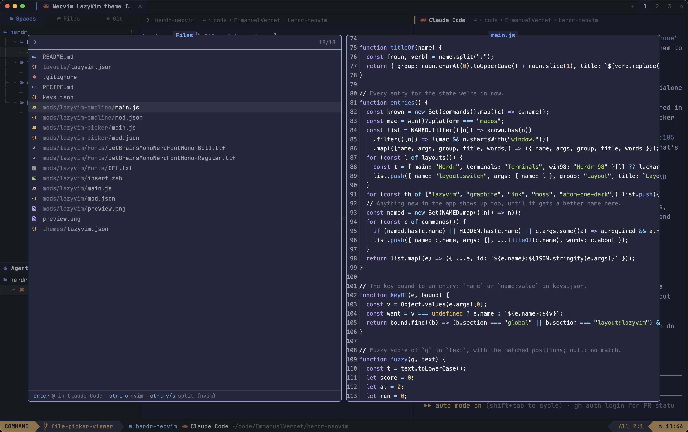
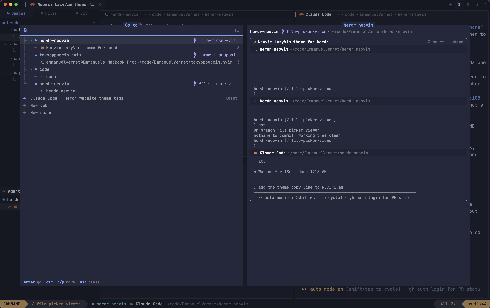

# herdr-neovim

A LazyVim look for the [Herdr](https://herdr.dev) app: bufferline tabs, a
neo-tree explorer of spaces, a Trouble-style agents list, nvim-style window
bars, a lualine whose mode follows the focused pane, a noice-style cmdline
on `cmd-shift-p` (`ctrl-shift-p` on Linux and Windows) and a snacks-style
picker with preview: files on `cmd-o` (`ctrl-shift-e`), spaces, tabs and
agents on `cmd-p` (`ctrl-shift-o`).





## Demo

https://github.com/user-attachments/assets/59c5c430-b5ca-4858-a29c-6eb278b876ea

## Install

Ask your agent to add `herdr.dev/layouts/EmmanuelVernet/herdr-neovim`, or by hand:

```sh
git clone https://github.com/EmmanuelVernet/herdr-neovim
cd herdr-neovim
cp layouts/lazyvim.json ~/.config/herdr-app/layouts/
cp themes/lazyvim.json ~/.config/herdr-app/themes/
cp -r mods/lazyvim mods/lazyvim-cmdline mods/lazyvim-picker mods/lazyvim-whichkey mods/lazyvim-dashboard mods/lazyvim-notify mods/lazyvim-flash ~/.config/herdr-app/mods/
herdr-app do layout.switch --name lazyvim
```

Then merge `keys.json` into `~/.config/herdr-app/keys.json` (add its
`layout:lazyvim` section), in this layout only:

| | macOS | Linux, Windows |
|---|---|---|
| cmdline | `cmd-shift-p` | `ctrl-shift-p` |
| Go to (spaces, tabs, agents) | `cmd-p` | `ctrl-shift-o` |
| Files (fuzzy, with preview) | `cmd-o` | `ctrl-shift-e` |
| Leader (which-key) | `ctrl-space` | `ctrl-space` |
| Flash (jump labels) | `cmd-;` | `ctrl-;` |

`ctrl-p` stays with the shell (previous command), hence `ctrl-shift-o`.

`ctrl-space` is the leader: a which-key popup lists what comes next
(`<space>` files, `,` buffers, `f` file/find, `b` buffer, `w` windows,
`<tab>` tabs, `a` agents, `u` ui, `q` quit, `D` dashboard, `j` flash). On macOS, `ctrl-space` also
switches input source when you have several; turn that off in System
Settings › Keyboard › Shortcuts if so.

No font to install: `mods/lazyvim/fonts/` ships JetBrainsMono Nerd Font Mono
(Regular and Bold, [SIL OFL](mods/lazyvim/fonts/OFL.txt)), loaded by Herdr when
the layout shows. Italics come from an installed
[JetBrainsMono Nerd Font](https://www.nerdfonts.com/font-downloads) if you have
one.

Optional, zsh only: show INSERT in lualine while you type at a shell prompt.

```sh
echo 'source ~/.config/herdr-app/mods/lazyvim/insert.zsh' >> ~/.zshrc
```

A snacks-style dashboard shows when the layout opens and on each new space:
`f` find file, `n` new tab, `g` go to, `c` config, `l` next layout. Any
other key, or Esc, closes it. `<leader>D` (or `Dashboard` in the cmdline)
brings it back.

Notifications (an agent needs you or is done, errors) show as snacks.notifier
boxes, the border in the level's color.

Flash (`cmd-;`, or `<leader>j`) puts a letter on every pane of the tab, every buffer and every
tabpage; press it to jump there, anything else cancels.

## Modes

| Focused pane | Mode |
|---|---|
| cmdline open | COMMAND |
| agent blocked (needs you) | REPLACE |
| agent working, or typing at a shell prompt | INSERT |
| pane zoomed | VISUAL |
| nvim, vim, helix, nano or emacs | CODE |
| shell or other program | TERMINAL |
| idle agent | NORMAL |

`ctrl-shift-l` cycles back to your other layouts. See [RECIPE.md](RECIPE.md)
for the full build brief.
