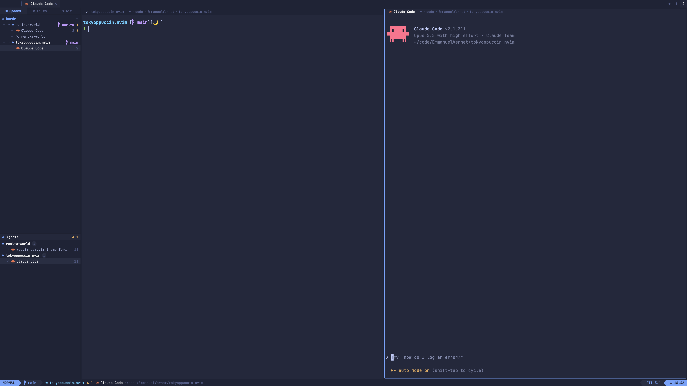

# herdr-neovim

A LazyVim look for the [Herdr](https://herdr.dev) app: bufferline tabs, a
neo-tree explorer of spaces, a Trouble-style agents list, nvim-style window
bars, a lualine whose mode follows the focused pane and a noice-style cmdline
on `cmd-shift-p`.



## Install

Ask your agent to add `herdr.dev/layouts/EmmanuelVernet/herdr-neovim`, or by hand:

```sh
git clone https://github.com/EmmanuelVernet/herdr-neovim
cd herdr-neovim
cp layouts/lazyvim.json ~/.config/herdr-app/layouts/
cp themes/lazyvim.json ~/.config/herdr-app/themes/
cp -r mods/lazyvim mods/lazyvim-cmdline ~/.config/herdr-app/mods/
herdr-app do layout.switch --name lazyvim
```

Then merge `keys.json` into `~/.config/herdr-app/keys.json` (add its
`layout:lazyvim` section): it binds `cmd-shift-p` to the cmdline and `cmd-p`
to its "Go to" list, in this layout only.

Needs [JetBrainsMono Nerd Font](https://www.nerdfonts.com/font-downloads).

Optional, zsh only: show INSERT in lualine while you type at a shell prompt.

```sh
echo 'source ~/.config/herdr-app/mods/lazyvim/insert.zsh' >> ~/.zshrc
```

## Modes

| Focused pane | Mode |
|---|---|
| cmdline open (`cmd-shift-p`) | COMMAND |
| agent blocked (needs you) | REPLACE |
| agent working, or typing at a shell prompt | INSERT |
| pane zoomed | VISUAL |
| shell or other program | TERMINAL |
| idle agent | NORMAL |

`ctrl-shift-l` cycles back to your other layouts. See [RECIPE.md](RECIPE.md)
for the full build brief.
