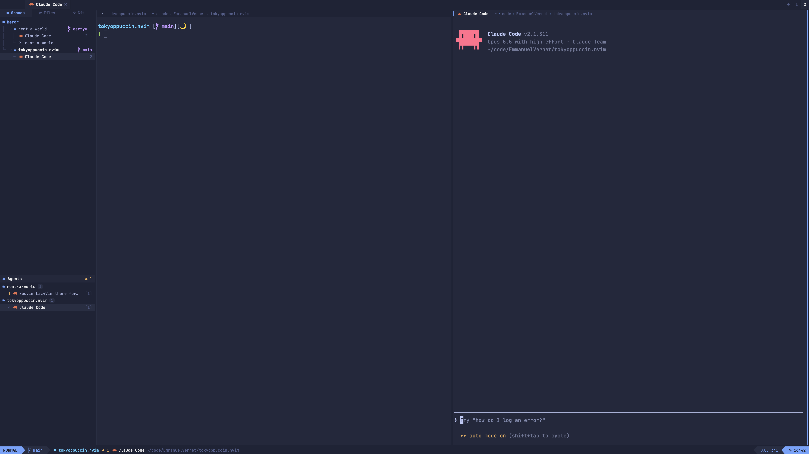

# LazyVim

Herdr dressed as a LazyVim session: a bufferline of tabs across the top, a
neo-tree style explorer of spaces and a Trouble style agents list on the left,
panes framed like nvim windows with a winbar each, and a lualine at the bottom
whose mode follows the focused pane (INSERT while an agent works or you type at
a shell prompt). Tokyonight moon colors, LazyVim's default, all in JetBrainsMono
Nerd Font.

## What you see

Top to bottom, on a `chrome` (`#1e2030`) background, no system title bar:

- **Bufferline**, 28px, full width, drags the window. Left padding 78px on
  macOS for the traffic lights (placed at `[12, 8]`). One buffer per tab of the
  active space: a `▎` marker (blue `ansi4` when active, invisible otherwise),
  the program icon, the name (bold when active), then a status sign or a `󰅖`
  close button; a 1px `border` line on its right. The active buffer sits on
  `background` (`#222436`), the rest on `chrome` in `dim`. On the right: a `+`
  (new-menu), then one numbered tabpage per space (active one bold on
  `background`), then window buttons where the system draws none.
- **Body**, a row with a 1px `border` divider:
  - **Sidebar**, left, 300px (160–560), `chrome`:
    - **Source selector**, 26px: three equal tabs `󰉋 Spaces`, `󰉓 Files`,
      `󰊢 Git`; the active one on `background`, blue and bold.
    - **Explorer stack** (weight 3): `Spaces` is a tree. Root row `󰝰 herdr`
      (blue, bold) with a `+` for a new space. Each space is a folder row:
      `├╴`/`└╴` guide (`dim` at 50% alpha), chevron, folder icon (blue, open
      when expanded), name (bold and `foreground` when active, `muted`
      otherwise), machine `󰒋 name` if remote, branch ` name` in magenta
      (`ansi5`), status sign. Under an expanded space, one row per tab with
      `│`/`├╴`/`└╴` guides, program icon, name, pane count when above 1, status
      sign. The active tab of the active space has the `hover` background (the
      cursorline). Rows are 22px, 12.5px text. `Files` and `Git` are Herdr's
      shipped `files` and `changes` mods.
    - **Agents** (weight 2, min 60): a 24px header on `background`
      (`󰚩 Agents`, then counts: ` n` blocked in red, ` n` working in yellow,
      ` n` done in green), then agents grouped by space: a folder row with a
      count pill, then one row per agent: status sign (`󰒲` in `dim` when idle),
      program icon, title, `[tab]` in `dim`. The focused agent has the `hover`
      background.
  - **Main**: the active tab's panes, 4px padding around them on `chrome`, 4px
    gap, radius 2, each pane on `background` with a 1px `raised` border; the
    focused pane's border is 1px `accent` (blue). Every pane, even a lone one,
    has a 22px **winbar**: `▎` (accent when focused, invisible otherwise),
    program icon, name (bold when focused), `[Z]` in yellow when zoomed, status
    sign, then the folder as breadcrumbs (`~  code  repo`). The focused
    winbar sits on `background` in `foreground`, the others on `chrome` in `dim`.
- **Lualine**, 24px, full width, powerline arrows (`` ``, 22px glyphs).
  Left: mode block (mode color background, dark `accent_foreground` text, bold),
  branch on `raised` in the mode color, then on `chrome`: `󱉭 space` in cyan,
  agent counts as diagnostics, the focused pane's icon, name and folder. Right:
  ` update` in yellow when an app update is ready, `󰒋 machine` when remote,
  then on `raised`: progress through the space's tabs (`All`, `Top`, `Bot`,
  `n%`) and `space:tab`, then a mode-colored block with ` HH:MM`.

Names: an agent's program name, a shell's folder name, else the terminal title;
a named tab keeps its name.

## How it behaves

- **Status signs** everywhere: working is a braille spinner (`frames`, 80ms) in
  `working`; blocked is `` in `blocked`; done is `●` in `done` (like a
  modified buffer); idle shows nothing (except `󰒲` in the agents list).
- **Mode**, from the focused pane, first match wins: blocked agent `REPLACE`
  (red `ansi1`); working agent or text at a shell prompt `INSERT` (green
  `ansi2`); zoomed pane `VISUAL` (magenta `ansi5`); shell or other non-agent
  program `TERMINAL` (cyan `ansi6`); idle agent `NORMAL` (blue `ansi4`).
  Clicking the mode opens the palette.
- **Bufferline**: click selects a tab, double-click renames, right-click opens
  the tab menu, `󰅖` closes, scroll wheel goes to the previous/next tab.
  Tabpage click selects the space, right-click opens the space menu.
- **Explorer**: click a space to select it (and expand it); click the active
  space or its chevron to fold it (kept in the mod's `localStorage`). Click a
  tab to show it. Right-click opens the space or tab menu.
- **Agents**: sorted pinned first, then blocked, done, working, idle, then
  start order; this order drives `agent.next` / `agent.prev`. Click focuses the
  agent's pane, or peeks a sub-agent.
- **Winbar**: click focuses the pane; on hover, split right, split down,
  zoom/unzoom and close buttons appear on the right.
- The clock refreshes every 15s; everything else re-renders on Herdr's data.

## Built from

- `layouts/lazyvim.json`: root `column` (`titlebar: "none"`, `theme:
  "lazyvim"`, `font` and `ui_font` `JetBrainsMono Nerd Font Mono`,
  `terminal_padding: [4, 8]`) → `tabs` block → `body` row (`sidebar` column:
  `sources` block, `explorer-body` stack of `tree` / `files` / `changes`,
  `trouble` block; `main` tab block with a pane frame and `header`) → `status`
  block.
- `themes/lazyvim.json`: tokyonight moon. Named like the layout, so Settings
  offers it only there; every color is read through `theme()`, so any theme works.
- `mods/lazyvim/main.js`: one mod, the piece chosen by `props().role`:
  `bufferline`, `sources`, `explorer`, `trouble`, `lualine`; no role plus a
  `pane` prop is the winbar. Uses `spaces`, `panes`, `agents`, `focused`,
  `layout`, `window`, `updates`, `setAgentOrder`, `openOverlay` (the shipped
  `menu` and `new-menu`), and the shipped `mods/pane/*.svg` icons. Commands:
  `tab.select|rename|close|prev|next`, `space.select|new`, `layout.select`,
  `pane.focus|split|zoom|close`, `terminal.peek`, `app.palette`, `app.update`,
  `window.*`.
- `mods/lazyvim/insert.zsh`: zsh hooks (`line-init`, `line-pre-redraw`,
  `preexec`) that set the terminal title to `lv:insert` while the prompt has
  text, the folder when empty, the command while it runs. Only inside Herdr
  terminals (`$HC_TERMINAL_SOCKET`).

## Watch out

- Needs **JetBrainsMono Nerd Font** installed; without it the icons and
  powerline arrows are boxes.
- Shell INSERT needs `source ~/.config/herdr-app/mods/lazyvim/insert.zsh` at
  the end of `~/.zshrc`, and a new shell. zsh only. Herdr can't see keystrokes,
  and an OSC 7501 report would turn the shell into an agent, hence the title.
- No COMMAND mode: mods can't tell when the palette is open.
- `done` turns `idle` once its pane is looked at, so it never shows as a mode.
- Read props with `props()`, not `init`'s first argument.
- Tab numbers in the tabpages are positions, not names.

## Done when

- `herdr-app check ~/.config/herdr-app/mods/lazyvim` passes and `herdr-app
  status` shows no errors after `layout.switch {name: "lazyvim"}`.
- Each role draws its own piece (not five lualines).
- Focusing another pane moves the blue border and the lit winbar.
- `printf '\e]7501;state=blocked\a'` in a shell turns the mode `REPLACE`;
  typing at a prompt (with `insert.zsh` sourced) turns it `INSERT`, `ctrl+u`
  back to `TERMINAL`; zooming the pane shows `VISUAL`.
- Clicking `Files` / `Git` swaps the explorer for the shipped panels.
